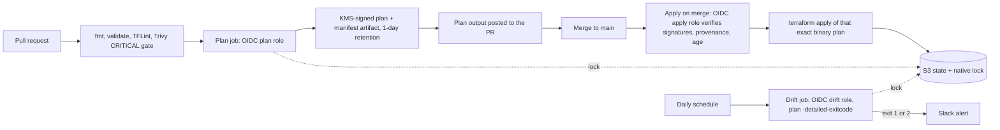
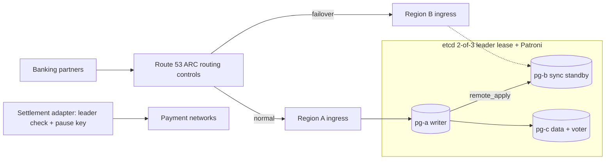

# AetherPay

Terraform infrastructure for the AWS assessment in `us-east-1`. Local AWS commands
use the `ubuntu` profile. The configuration has not been deployed.

## Implemented

| Component | Configuration |
| --- | --- |
| [Networking](terraform/modules/networking/README.md) | Three-tier VPC, restricted security groups, private ECR/Secrets Manager/SQS endpoints, and an ECR-only S3 gateway endpoint |
| [Ingress](terraform/modules/ingress/README.md) | Public ALB, TLS 1.3-only HTTPS listener, regional WAF, and 1,000 requests per five minutes per source IP |
| [Compute](terraform/modules/compute/README.md) | Private ECS Fargate ingestor, separate workload roles, and CPU/memory/queue-depth scaling |
| [Cache](terraform/modules/cache/README.md) | Baseline-compatible single-node Redis in isolated subnets, with resource destruction blocked |
| [Messaging](terraform/modules/messaging/README.md) | Standard ingestion queue with SSE-SQS encryption and long polling, plus a dead-letter queue |
| [Security](terraform/modules/security/README.md) | CMK-encrypted secret containers, scoped access, and PostgreSQL/signing-key rotation functions |
| [State bootstrap](terraform/environments/staging/bootstrap/README.md) | Private, versioned S3 state with encryption and native locking; GitHub OIDC provider, least-privilege plan/apply/drift roles, and the plan-signing key |
| [GitHub Actions](.github/workflows) | OIDC plan/apply/drift jobs, KMS-signed saved plans posted to the PR, static checks, and Slack drift alerts |

[Staging](terraform/environments/staging/README.md) connects these modules. Supply
an issued ACM certificate, a private ECR repository and published image, and a
PostgreSQL target accessible through the isolated tier's database security group.
Database provisioning and application implementation remain later steps. Follow
[How to launch](#how-to-launch) to supply the roles, signing key, backend
configuration, and staging inputs. The [DR ADR](docs/ADR-001-Disaster-Recovery.md) describes a proposed
production design; its multi-Region capabilities are not deployed by this project.

The application must serve its configured readiness path, use private Redis TCP,
retrieve secrets through the SDK, and refresh credentials after rotation. Signing
and verification must coordinate current/previous keys. WAF rate enforcement is
approximate.

## CIDR allocation

The VPC is `10.24.0.0/20`. Sorted AZ names determine the three stable slots.

| Tier | AZ 1 | AZ 2 | AZ 3 | Routes |
| --- | --- | --- | --- | --- |
| Public | 10.24.0.0/24 | 10.24.1.0/24 | 10.24.2.0/24 | Local and internet gateway |
| Application | 10.24.3.0/24 | 10.24.4.0/24 | 10.24.5.0/24 | Local and S3 gateway endpoint |
| Isolated | 10.24.6.0/24 | 10.24.7.0/24 | 10.24.8.0/24 | Local only |

`10.24.9.0/24` through `10.24.15.0/24` are reserved. Application and isolated
subnets have no default internet or NAT route. Tasks have no public IP.

## Architecture


Ports shown are defaults. The supplied PostgreSQL target must satisfy the
networking contract; this repository does not create it. Redis remains the
baseline single-node resource, without cache TLS or multi-AZ failover.

### Delivery pipeline



All cloud jobs share one `terraform-staging` concurrency group that queues instead
of cancelling. Bootstrap creates the OIDC provider, the three roles, and the
signing key.

### Proposed disaster recovery



This is the [ADR-001](docs/ADR-001-Disaster-Recovery.md) design. It is not deployed:
the project is limited to `us-east-1`.

## How to launch

You need Terraform 1.17.1, Python 3.10 or later with pip, and AWS CLI credentials
for the `ubuntu` profile. Nothing in this repository has been deployed yet. Run
every command from the repository root.

Have three things ready first: an issued ACM certificate that covers your ingestion
hostname, a private ECR repository with the published image, and a PostgreSQL
target reachable through the isolated tier's database security group. The image
must serve `/health` on port 8080, connect to Redis over private TCP, and read
secrets through the SDK.

### 1. Create the state backend and CI identity

The CI roles trust immutable GitHub subjects, so bootstrap needs the numeric ID of
the repository owner and of the repository. The repository is private, so look
them up with the GitHub CLI after `gh auth login`:

```sh
mkdir -p -m 700 .aetherpay
gh api repos/{owner}/{repo} --jq '.owner.id, .id'
```

Create the variable file from those two numbers. It lives in `.aetherpay/`, which
git ignores, and the plan command below passes it with `-var-file`:

```sh
cat > .aetherpay/bootstrap.tfvars <<'EOF'
github_owner_id      = "REPLACE_WITH_OWNER_ID"
github_repository_id = "REPLACE_WITH_REPOSITORY_ID"
EOF
```

Open `.aetherpay/bootstrap.tfvars` and replace `REPLACE_WITH_OWNER_ID` and
`REPLACE_WITH_REPOSITORY_ID` with the first and second number from the `gh api`
output. Keep the quotes. If the project already has a GitHub OIDC provider, add
this line with its ARN:

```hcl
github_oidc_provider_arn = "arn:aws:iam::<account ID>:oidc-provider/token.actions.githubusercontent.com"
```

The applying administrator needs IAM, KMS, and S3 permissions.

Run the commands in two parts, and start part 2 only after the apply in part 1
finishes without errors. Pasting everything at once keeps going after a failure and
leaves a `backend.tf` that points at a bucket that does not exist.

Part 1 creates the bucket and CI identity with local state:

```sh
export AWS_PROFILE=ubuntu
terraform -chdir=terraform/environments/staging/bootstrap init
terraform -chdir=terraform/environments/staging/bootstrap plan -var-file=$PWD/.aetherpay/bootstrap.tfvars -out=$PWD/.aetherpay/state.tfplan
terraform -chdir=terraform/environments/staging/bootstrap apply $PWD/.aetherpay/state.tfplan
```

Part 2 writes the backend configs and moves the state into the new bucket:

```sh
terraform -chdir=terraform/environments/staging/bootstrap output -json backend_configs > $PWD/.aetherpay/backends.json
python3 -c 'import json; d=json.load(open(".aetherpay/backends.json")); json.dump(d["bootstrap"],open(".aetherpay/bootstrap.backend.json","w")); json.dump(d["staging"],open(".aetherpay/staging.backend.json","w"))'
cp terraform/environments/staging/bootstrap/backend.tf.example terraform/environments/staging/bootstrap/backend.tf
terraform -chdir=terraform/environments/staging/bootstrap init -migrate-state -backend-config=$PWD/.aetherpay/bootstrap.backend.json
```

The last command asks whether to copy the existing local state to the new S3
backend. Type `yes` and press Enter. Typing anything else cancels the migration,
and you can run the command again.

Plans, backend configs, and the seed virtualenv live in `.aetherpay/`, which git
ignores. Part 1 uses local state because the bucket does not exist yet, and the
last command of part 2 moves that state into the bucket. Keep the local state file
and its backup until the migration is verified.

### 2. Configure staging

Copy the example into `.aetherpay/`, which git ignores, and replace the example
identifiers with resources from your project. Leave database passwords and signing
keys out of it.

```sh
cp terraform/environments/staging/staging.tfvars.example .aetherpay/staging.tfvars
sed -i 's/123456789012/<your AWS account ID>/g' .aetherpay/staging.tfvars
```

Then edit `.aetherpay/staging.tfvars` and replace `certificate_arn` with the ARN of
your issued ACM certificate, and `database.host` with your PostgreSQL endpoint.
Check that no placeholders remain:

```sh
grep -nE 'replace-with|123456789012|00000000-0000-4000' .aetherpay/staging.tfvars
```

Then build the rotation package and initialize the backend:

```sh
python3 terraform/modules/security/rotation/build_package.py
terraform -chdir=terraform/environments/staging init -backend-config=$PWD/.aetherpay/staging.backend.json
```

### 3. Create networking and the secret containers

The first deployment needs the secret containers before the service starts or
rotation turns on, so target those modules first. This also creates the task-role
identities and the ingestion queue, without starting ECS.

This step creates only the Secrets Manager and S3 endpoints, which the brief needs
for secret access. The ECR and SQS endpoints belong to the ECS service, so step 5
creates them with it.

If you also run step 5 as a test, you can shrink it in `.aetherpay/staging.tfvars`.
Set `capacity = { min = 1, max = 3 }` to run one Fargate task instead of two. Set
`enable_cache = false` to skip the Redis cache. The application then gets no
`REDIS_HOST` or `REDIS_PORT`, so only do that if your test image doesn't need Redis.
Keep both defaults for a real deployment.

```sh
terraform -chdir=terraform/environments/staging plan -var-file=$PWD/.aetherpay/staging.tfvars -var='enable_rotation=false' -target=module.networking -target=module.security -out=$PWD/.aetherpay/seed.tfplan
terraform -chdir=terraform/environments/staging apply $PWD/.aetherpay/seed.tfplan
terraform -chdir=terraform/environments/staging output secret_arns
terraform -chdir=terraform/environments/staging output -raw seed_access_policy
```

### 4. Set the first secret values

Step 3 created two empty secret containers. This step stores their first values. Use
an identity that has the seed permissions printed above. The helper needs boto3 and
must run in an interactive terminal, because it reads the password with echo off.

Print the two secret ARNs from step 3:

```sh
export AWS_PROFILE=ubuntu
terraform -chdir=terraform/environments/staging output secret_arns
```

Create the helper's Python environment, then run it with the `database` and
`signature` ARNs from that output:

```sh
python3 -m venv .aetherpay/seed-venv
.aetherpay/seed-venv/bin/pip install -r terraform/modules/security/rotation/requirements.txt
.aetherpay/seed-venv/bin/pip install "botocore[crt]"
.aetherpay/seed-venv/bin/python scripts/seed_secrets.py --database-secret-arn '<database ARN>' --signature-secret-arn '<signature ARN>'
```

The second `pip install` is only needed when your AWS profile signs in with `aws login`
(it has a `login_session` line in `~/.aws/config`). Without it, the helper stops with
`MissingDependencyException`, because botocore needs the `awscrt` package to read
those credentials. The Lambda requirements file leaves it out on purpose.

The helper asks for these values:

- PostgreSQL host, the same as `database.host` in your tfvars.
- Port, where Enter accepts 5432.
- Database name, the same as `database.name` in your tfvars.
- The existing application database user.
- That user's current password, typed twice with no echo.

It stores them as the database secret. It also generates a random 32-byte signing key
in memory and stores that as the signature secret. It prints or saves no secret values,
and a good run ends with `Database secret initialized.` and `Signature secret initialized.`

The helper only stores what you type and never connects to PostgreSQL, so the database
does not have to exist yet. Enter the values you will use when you create it. The helper
leaves a secret that already has a value unchanged, so to redo one you must first remove
its current version in AWS.

The PostgreSQL target and credentials must work before you enable rotation. Step 5 sets
`enable_rotation=true`, and turning rotation on starts a rotation immediately, which
fails while the database is unreachable.

If the helper stops with an error code such as `AccessDeniedException` or `ValueError`,
the code is the only detail it prints. Check your AWS identity and the ARNs you passed.

### 5. Deploy everything

Review the full plan before applying it.

```sh
terraform -chdir=terraform/environments/staging plan -var-file=$PWD/.aetherpay/staging.tfvars -var='enable_rotation=true' -out=$PWD/.aetherpay/staging.tfplan
terraform -chdir=terraform/environments/staging apply $PWD/.aetherpay/staging.tfplan
```

Use full plans from here on. Before this step the application must already handle
SDK secret retrieval and refresh, retries, and signing-key overlap. After it,
check ingress, private connectivity, scaling, and rotation by hand, because
Terraform cannot confirm them.

### 6. Turn on GitHub Actions

Print the AWS values and add them in your repository on GitHub. Open Settings, then
Secrets and variables, then Actions. The page has two tabs. On the Variables tab, choose
New repository variable, type the name, paste the value, and choose Add variable. Do
this once for each row in the table below.

No database credentials go to GitHub. The database user and password stay in AWS
Secrets Manager, where step 4 stored them. GitHub holds only the host, port, and
database name, inside `STAGING_TFVARS_JSON`, and none of those three is secret.

```sh
terraform -chdir=terraform/environments/staging/bootstrap output -json github_actions_variables
```

| Repository variable | Value |
| --- | --- |
| `AWS_PLAN_ROLE_ARN` | Plan role ARN from the bootstrap output |
| `AWS_APPLY_ROLE_ARN` | Apply role ARN from the bootstrap output |
| `AWS_DRIFT_ROLE_ARN` | Drift role ARN from the bootstrap output |
| `PLAN_SIGNING_KEY_ARN` | RSA signing key ARN in `us-east-1` |
| `TF_STATE_BUCKET` | State bucket name |
| `TF_STATE_KEY` | `staging/terraform.tfstate` (the helper rejects other keys) |
| `AWS_ACCOUNT_ID` | Twelve-digit project ID, which the bucket name must contain |
| `STAGING_TFVARS_JSON` | Your non-secret staging inputs as one JSON object (see below), with `enable_rotation` set to `true` |

Create `STAGING_TFVARS_JSON` from your `.aetherpay/staging.tfvars` instead of typing it.
Terraform evaluates the file for you, and the command keeps only the fields CI accepts:

```sh
export AWS_PROFILE=ubuntu
echo 'jsonencode({project_name=var.project_name, availability_zones=var.availability_zones, application_port=var.application_port, database=var.database, cache=var.cache, queue_visibility_timeout_seconds=var.queue_visibility_timeout_seconds, queue_max_receive_count=var.queue_max_receive_count, certificate_arn=var.certificate_arn, health_check_path=var.health_check_path, ecr_repository_arn=var.ecr_repository_arn, image_uri=var.image_uri, task_cpu=var.task_cpu, task_memory=var.task_memory, capacity=var.capacity, scaling=var.scaling, rotation_days=var.rotation_days, enable_rotation=true, tags=var.tags})' \
  | terraform -chdir=terraform/environments/staging console -no-color -var-file=$PWD/.aetherpay/staging.tfvars \
  | python3 -c 'import sys,json; print(json.dumps(json.loads(json.loads(sys.stdin.read().strip())), indent=2))' \
  > .aetherpay/staging.tfvars.json
```

Git ignores the result. Check that CI accepts it before you paste it, using the same
helper the workflows run, with your own account ID and bucket name:

```sh
AWS_ACCOUNT_ID=<account ID> TF_STATE_BUCKET=<state bucket> TF_STATE_KEY=staging/terraform.tfstate \
  STAGING_TFVARS_JSON="$(cat .aetherpay/staging.tfvars.json)" \
  python3 scripts/ci/pipeline.py config --work-dir .aetherpay/ci-check
```

No output other than a clean exit means CI will take it. Then paste the contents of
`.aetherpay/staging.tfvars.json` into the `STAGING_TFVARS_JSON` variable. The file
has no secrets, but it does hold your real certificate ARN and database host, so
replace the database host placeholder before you rely on it.

CI always deploys the defaults for `enable_cache` and the other test settings, so those
lines in your tfvars are ignored. A CI plan therefore keeps the Redis cache even if
your local tfvars turned it off.

CI also insists that `enable_rotation` is `true` and rejects the file otherwise, with
"Complete local secret initialization before normal CI deployment." That is deliberate.
The workflows never seed secrets and never turn rotation off, so they assume the
step 4 values exist and that PostgreSQL is reachable. Turning rotation on starts a
rotation immediately, and with no working database the database rotation fails. If you
turned rotation off for a test, the first CI plan will show both rotation settings being
added back, so create the database first or leave that plan unapplied.

Leave passwords, signing keys, AWS credentials, and the Lambda ZIP path out of
`STAGING_TFVARS_JSON`, since CI builds the package itself.

Then protect `main`, require the checks and at least one approving review before
merging, and limit write access to trusted maintainers. Merging is now the approval
for a deployment, so branch protection is the gate.

The formatting, validation, lint, and security checks run on every push to any branch.
A pull request runs only the plan, which signs it and posts it as a comment. Require the
checks in branch protection, because the plan no longer waits for them. Merging it applies
that plan. The apply workflow starts on the push to `main`, finds the merged pull
request and its newest successful plan run for the final commit, and then verifies the
signatures, the plan's age, and that the merged code matches what was planned. Only
then does it apply the saved plan. Use **Create a merge commit** and do not push to the
pull request after its plan runs. A direct push to `main`, a fork, a plan older than a
day, or a merge that differs from the plan applies nothing, and the job log says why.

The apply workflow also has a manual trigger. Run it from `main` with the pull request
number, the plan run ID, and the attempt number when you need to re-apply or when the
automatic run could not choose a plan. A daily job runs `terraform plan -detailed-exitcode`
and alerts Slack on exit code 1 or 2.

For the legacy cache refactor, use the separate
[migration procedure](docs/VULNERABILITY-AUDIT.md#cache-state-migration). It
keeps the original backend and network, while fresh staging creates a new VPC.

## Local validation

```sh
python3 terraform/modules/security/rotation/build_package.py
terraform fmt -check -recursive terraform
terraform -chdir=terraform/environments/staging/bootstrap init -backend=false
terraform -chdir=terraform/environments/staging/bootstrap validate
terraform -chdir=terraform/environments/staging init -backend=false
terraform -chdir=terraform/environments/staging validate
tflint --init --config "$PWD/.tflint.hcl"
tflint --chdir=terraform --recursive --config "$PWD/.tflint.hcl" --minimum-failure-severity=warning
trivy config --severity CRITICAL --exit-code 1 --skip-dirs terraform/modules/security/.build terraform
```

Staging validation covers all child modules. To check one module, run
`terraform init -backend=false` and `terraform validate` in its directory.
Provider and plugin installs need network access. Validation checks configuration
only. It does not verify live certificates, targets, database credentials, IAM
permissions, or application behavior, and there is no custom Terraform test suite.
